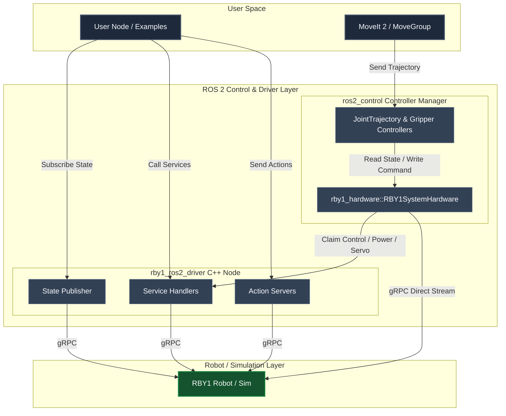

# Package Architecture

## System Architecture

The RB-Y1 ROS 2 packages support both direct control (services, actions and topics of the `rby1_ros2_driver` C++ node) and `ros2_control` (the `rby1_hardware::RBY1SystemHardware` system interface), with or without MoveIt 2.

## Package Structure

| Package | Role | Page |
|---------|------|------|
| `rby1_driver` | C++ driver node. Wraps the RB-Y1 SDK and exposes the ROS 2 interface. Its parameters are in `config/driver_parameters.yaml`. | [Driver Parameters](config_driver_parameters.md) |
| `rby1_msgs` | Messages, services and actions of the driver. | [Custom Message Types](custom_message_types.md) |
| `rby1_examples` | Python examples 01 to 16 of the driver's features. | [Examples](examples.md) |
| `rby1_description` | URDFs and meshes of every model and version, and a state publisher launch for RViz. | [Visualization & Robot Description](visualization_and_robot_description.md) |
| `rby1_hardware` | `ros2_control` SystemInterface plugin (`RBY1SystemHardware`), and a launch file that runs `ros2_control` without MoveIt. | [ros2_control Hardware Interface](hardware_interface.md) |
| `rby1_moveit_a_1_0`, `rby1_moveit_a_1_1`, `rby1_moveit_a_1_2` | MoveIt 2 configuration for **Model A v1.0, v1.1, v1.2** (SRDF, controllers, kinematics, joint limits) with `demo.launch.py`. | [MoveIt 2](rby1_moveit2.md) |
| `rby1_moveit_m_1_0`, `rby1_moveit_m_1_1`, `rby1_moveit_m_1_2`, `rby1_moveit_m_1_3` | MoveIt 2 configuration for **Model M v1.0, v1.1, v1.2, v1.3**. | [MoveIt 2](rby1_moveit2.md) |
| `rby1_moveit_executor` | A planner that takes tool pose targets, plans with MoveIt (OMPL) around the planning scene and runs the result through the driver. | [MoveIt Planner](moveit_planner.md) |
| `rby1_moveit_objects` | Objects in the planning scene: obstacles (`scene`), modules on the robot (`objects.launch.py`), an obstacle kept where a topic says. | [MoveIt Planner](moveit_planner.md#planning-scene-rby1_moveit_objects) |
| `rby1_tools` | Camera publisher (Intel RealSense), the gripper (model, planning-scene parts, driver) and the 2D LiDARs. | [Tools](tools.md) |
| `rby1_bringup` | One launch file that starts the driver and whatever runs with it, by flags. | [Bringup](bringup.md) |

### Sequence & Architecture Flow (Mermaid Diagram)

Verified against: rby1-ros2 v1.0.0 package tree, `Doc/manual/01_overview.md` (Packages).
